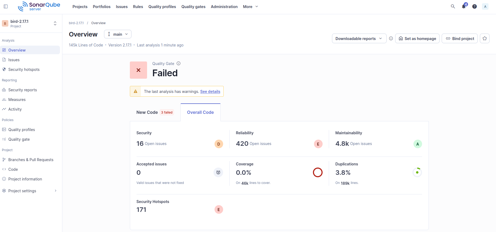
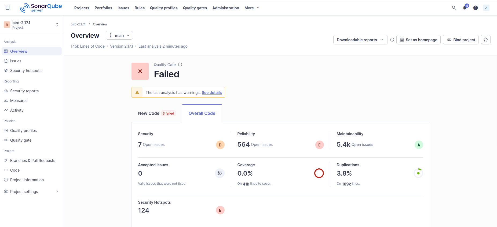

# Running SonarQube

## Objective

Analyze the BIRD v2.17.1 source code using SonarQube by creating a project, configuring the scanner, executing the analysis, and exploring the results in the SonarQube web interface.

---

## Creating a Project

A new project was created in the SonarQube web interface.

Project information:

| Property | Value |
|----------|-------|
| Project Name | bird-2.17.1 |
| Project Key | bird-2.17.1 |

The default **New Code Definition** settings were used.

---

## Generating an Authentication Token

A user authentication token was generated from:

```
My Account → Security → Generate Token
```

The generated token was used by SonarScanner to authenticate with the SonarQube server.

---

## Configuring the Project

A `sonar-project.properties` file was created in the root directory of the BIRD project.

Contents:

```properties
sonar.projectKey=bird-2.17.1
sonar.projectName=bird-2.17.1
sonar.projectVersion=2.17.1

sonar.sources=.
sonar.sourceEncoding=UTF-8

sonar.host.url=http://localhost:9000
sonar.token=<YOUR_TOKEN>
```

---

## Running SonarScanner

Command:

```bash
sonar-scanner
```

## Result

The analysis completed successfully and the results were uploaded to the local SonarQube server.

---

## Exploring the SonarQube Interface

After the analysis finished, the project dashboard was opened in the SonarQube web interface.

The following sections were explored:

- **Overview** – Displays the overall analysis summary and project metrics.
- **Issues** – Lists detected bugs, vulnerabilities, code smells, and security hotspots.
- **Rule Details** – Provides detailed information about each rule, including its description, severity, and recommended fix.
- **Filters** – Allows filtering issues by severity, type, status, rule, file, and other criteria.
- **Navigation** – Enables navigation from an issue directly to the affected source file and line number.

---

# Configuring SonarQube C/C++ Build Context

## Objective

SonarQube C/C++ analysis requires information about the actual compilation process to correctly understand:

- Compiler configuration
- Include directories
- Preprocessor definitions
- Active macros
- Compiled source files

Without this information, the analyzer may produce inaccurate results and increase the number of false positive findings.

To provide this information, the **SonarQube Build Wrapper** was used.

---

# Downloading Build Wrapper

The Build Wrapper was downloaded directly from the local SonarQube server to ensure compatibility with the installed C/C++ analyzer version.

## Download Command

```bash
wget http://localhost:9000/static/cpp/build-wrapper-linux-x86.zip
```

---

## Extracting the Archive

```bash
unzip build-wrapper-linux-x86.zip
```

---

## Configuring the Build Wrapper

```bash
sudo mv build-wrapper-linux-x86 /opt/
```

A symbolic link was created:

```bash
sudo ln -s /opt/build-wrapper-linux-x86/build-wrapper-linux-x86-64 /usr/local/bin/build-wrapper-linux-x86-64
```

---

## Verification

```bash
build-wrapper-linux-x86-64 --help
```

**Output:**

```
build-wrapper, version 6.81.1 (linux-x86)
```

---

## Running Build Wrapper During Compilation

A clean build was performed while monitoring the compilation process using Build Wrapper.

First, previous build artifacts were removed:

```bash
make clean
```

Then the project was rebuilt using:

```bash
build-wrapper-linux-x86-64 --out-dir bw-output make -j1
```

The `-j1` option was used to perform a single-threaded build and ensure that all compilation commands were completely captured by Build Wrapper.

---

## Generated Build Context Files

After the build completed, the following files were generated:

```
bw-output/
├── build-wrapper-dump.json
├── build-wrapper.log
└── compile_commands.json
```

The generated `build-wrapper-dump.json` contains the compilation information required by SonarQube for C/C++ analysis.

The collected information includes:

- Compiler commands
- Source files compiled during the build
- Include directories
- Compiler flags
- Preprocessor definitions

---

## Updating SonarQube Configuration

The Build Wrapper output directory was added to the SonarQube configuration.

**Updated `sonar-project.properties`:**

```properties
sonar.projectKey=bird-2.17.1
sonar.projectName=bird-2.17.1
sonar.projectVersion=2.17.1

sonar.sources=.

sonar.sourceEncoding=UTF-8

sonar.host.url=http://localhost:9000
sonar.token=<YOUR_TOKEN>

sonar.cfamily.build-wrapper-output=bw-output
```

The following property enables SonarQube to use the generated C/C++ build context:

```properties
sonar.cfamily.build-wrapper-output=bw-output
```

---

## Running SonarQube Analysis with Build Context

The analysis was executed again using the generated build context:

```bash
sonar-scanner
```

---

## Result

The analysis completed successfully using the compilation information collected by Build Wrapper.

The analyzer was able to use:

- Real compiler options
- Actual include paths
- Macro definitions
- Compiled translation units

This improved the accuracy of C/C++ analysis compared with the initial analysis without build context.

---

## Comparing Analysis Results

The results before and after enabling Build Wrapper were compared.

| Metric | Without Build Context | With Build Context |
|--------|----------------------|-------------------|
| Security Issues | Higher number of findings | Reduced number of findings |
| Security Hotspots | Higher number | Reduced number |
| Reliability Issues | Lower number | Increased due to deeper analysis |
| Code Smells | Less detailed detection | More complete detection |

The reduction in security-related findings indicates that some previous findings were caused by missing compilation context and were reduced after providing the real build information.

The increase in reliability issues does not necessarily indicate lower code quality. It is a result of more accurate analysis of the real compiled code and better understanding of project structure.

---

## SonarQube Dashboard Before Build Wrapper

The following screenshot shows the initial SonarQube analysis results before adding C/C++ build context information.


---

## SonarQube Dashboard After Build Wrapper Integration

The following screenshot shows the SonarQube analysis results after enabling Build Wrapper and providing compilation context.



---
